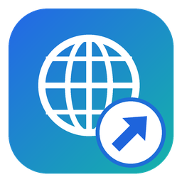
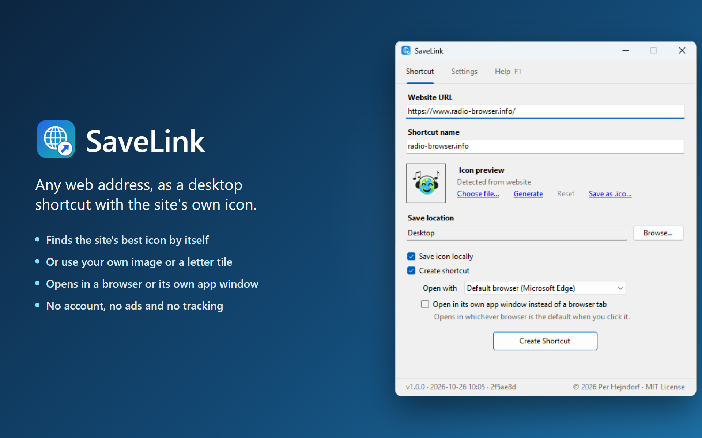

#  SaveLink

[](https://github.com/kreaton/SaveLink/releases/latest)
[](https://github.com/kreaton/SaveLink/actions/workflows/release.yml)
[](LICENSE)
[](https://github.com/kreaton/SaveLink/stargazers)

⭐ If SaveLink earns a place on your machine, [star it on GitHub](https://github.com/kreaton/SaveLink) — it's free, made by one developer, and stars are how other people find it.



**Turn any web address into a desktop shortcut that carries the site's own icon.**

Paste or drag a link into SaveLink. It finds the page's title and best icon, and makes a shortcut on your Desktop. Your favourite sites then sit on the Desktop looking like apps, instead of a row of identical browser icons.

**[⬇ Download SaveLink for Windows](https://github.com/kreaton/SaveLink/releases/latest/download/SaveLink-win-Setup.exe)** (Windows 10 or 11, 64-bit)

## What it does

- **Finds the real icon.** It looks for the site's best icon, and makes a coloured letter tile if there isn't one.
- **Lets you choose the icon.** Use your own image, generate a letter tile, or go back to the website's icon. You can also save the icon as a multi-size `.ico` file.
- **Opens the way you want.** Use your default browser, a specific browser, or a clean app window with no tabs or address bar, much like a web app pinned to a phone's home screen.
- **Stays quick.** A link on the clipboard is already filled in when SaveLink starts, and you can drop links, selected text or `.url` files onto the window.
- **Respects your privacy.** There's no account, no ads and no tracking. See the [privacy policy](PRIVACY.md).

## Install

1. Download **[SaveLink-win-Setup.exe](https://github.com/kreaton/SaveLink/releases/latest/download/SaveLink-win-Setup.exe)** and run it.
2. If Windows says "Windows protected your PC", choose **More info**, then **Run anyway**. The warning appears because the installer isn't code-signed.
3. SaveLink installs just for you, adds Desktop and Start menu shortcuts, and starts. If the .NET 10 Desktop Runtime is missing, the setup installs it too, and Windows may ask for permission.

**Updates:** when a new version is out, an **Update to v…** link appears at the bottom of the window. Click it, and SaveLink updates and restarts.

**Uninstall:** use **Settings → Apps → Installed apps**. Your shortcuts and saved icons stay where they are, because they're your files.

## Make a shortcut

1. Copy a link, or drag one onto the window.
2. Check the name and icon.
3. Click **Create Shortcut**.


Press **F1** in the app for help with every option.

| Settings | Help |
|---|---|
|  |  |

## Choosing how a shortcut opens

| Choose | What the shortcut does |
|---|---|
| **Default browser** | Opens in whichever browser is your default when you click it. |
| **A specific browser** | Always opens in that browser, even if your default changes. |
| **App window** | Opens in its own window with its own taskbar button, and no tabs or address bar. |

App windows work with Edge, Chrome, Brave, Vivaldi and Chromium. Firefox and Opera can open links, but they don't have an app-window mode.

## Start SaveLink with a hotkey

- **Windows' own shortcut key:** right-click a Desktop shortcut to SaveLink, choose **Properties** and set **Shortcut key** (always `Ctrl+Alt` plus a key).
- **PowerToys Keyboard Manager:** this works with any key combination. Use **Remap a shortcut** with the action **Run program**, and pick `SaveLink.exe`.

## Good to know

- **Keep your saved icons.** Shortcuts point at the icon files in `Documents\SaveLink\Icons`, or the folder you chose in Settings. If you delete the files, the shortcuts lose their icons.
- **Moving shortcuts to another PC.** A copied shortcut opens fine, but it shows no icon unless its icon file is copied to the same place.
- **Uninstalling a browser.** Shortcuts tied to a specific browser or an app window stop working. Default-browser shortcuts keep working.

## For developers

SaveLink is a .NET 10 Windows Forms app. To run it from source:

```
dotnet run --project SaveLink
```

- [Building, releasing and publishing to the Microsoft Store](docs/DEVELOPMENT.md)
- [The promo video](Promo/README.md), made with Remotion

Bug reports and ideas are welcome in [Issues](https://github.com/kreaton/SaveLink/issues).

## License & Authorship

This project is distributed under the terms of the [MIT License](LICENSE).

**AI authorship note:** Most of the source code in this repository was generated with AI coding agents (Claude Code), under my direction and review. Purely AI-generated material may not be eligible for copyright protection in some jurisdictions. To the extent any part of this project is protected by copyright, it is licensed under the MIT License, and the license's warranty and liability disclaimers apply to the project as a whole.

<!-- notices:start -->
### Independent development

SaveLink is an independent, personal project developed by Per Hejndorf. It is not affiliated with, endorsed by or sponsored by Microsoft or any other rights holder. Product names and logos are trademarks of their respective owners and are used only to identify the services and tools the project works with.

### Third-party notices and asset provenance

[THIRD-PARTY-NOTICES.md](THIRD-PARTY-NOTICES.md) lists every third-party library, font and online service the project uses, with version, licence, source and whether it was modified. It also records where the icons, images, audio and video came from and how they are licensed. A few assets are not covered by the MIT License; [THIRD-PARTY-NOTICES.md](THIRD-PARTY-NOTICES.md) marks them and states their terms.
<!-- notices:end -->
