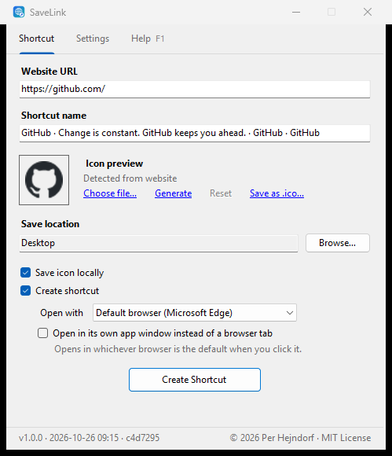
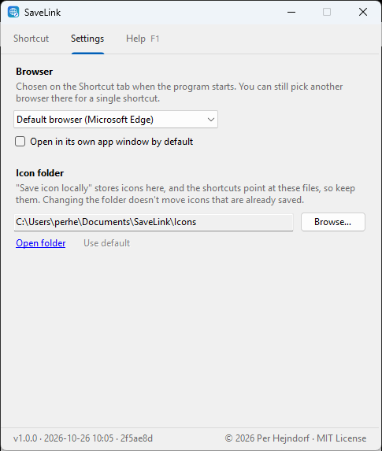
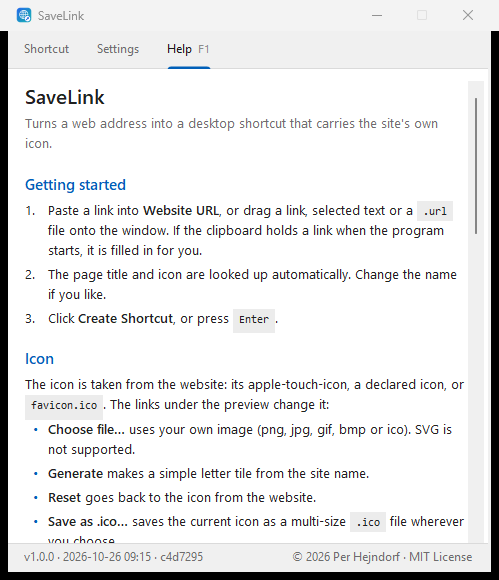

# {width=40} SaveLink

[](https://gitlab.com/phejndorf/SaveLink/-/pipelines)
[](LICENSE)

**Turn any web address into a desktop shortcut that carries the site's own icon.**

Paste or drag a link into SaveLink, and it finds the page's title and best icon and makes a shortcut on your Desktop. The shortcut opens in your default browser, in a browser you pick, or in its own app window without tabs or address bar, much like a web app pinned to a phone's home screen.



| Settings | Help |
|---|---|
|  |  |

## Features

- **Finds the real icon:** the site's apple-touch-icon, its declared icons or `favicon.ico`, with Google's favicon service as a last resort. If there is none, it makes a coloured letter tile.
- **Your choice of icon:** use your own image, generate a letter tile, reset to the website's icon, or save the icon as a multi-size `.ico` file.
- **Your choice of browser:** the default browser, a specific installed browser, or an app window (Edge, Chrome, Brave, Vivaldi).
- **Quick to use:** a link on the clipboard is filled in when SaveLink starts, and you can drop links, selected text or `.url` files onto the window.
- **Settings** for the preferred browser and the folder icons are saved in.
- **Built-in help** (F1).

## Using it

1. Copy a link, or drag one onto the window.
2. Check the name and icon.
3. Click **Create Shortcut**.

The Help tab inside the app explains every option. Its text is [`SaveLink/Help.md`](SaveLink/Help.md).

### Start it with a hotkey

- **Windows' own shortcut key:** right-click a Desktop shortcut to SaveLink, choose **Properties** and set **Shortcut key** (always `Ctrl+Alt` plus a key). For the Store version, make that Desktop shortcut by dragging SaveLink from the Start menu's **All** list onto the Desktop.
- **PowerToys Keyboard Manager:** **Remap a shortcut** with the action **Run program** and the program `SaveLink.exe`. This works for any key combination and reacts instantly.

## Browsers

The **Open with** list holds "Default browser" plus every browser installed on the PC. The browser selected when the app starts comes from Settings.

**How browsers are found** (`SaveLink/Services/BrowserService.cs`):

- **Installed browsers** come from `SOFTWARE\Clients\StartMenuInternet`, read in HKCU (per-user installs) and in both the 64- and 32-bit views of HKLM. Every browser that can be made the Windows default must register there, so this is the same list Windows shows under *Default apps*. No install paths are hard-coded. Each entry's `shell\open\command` gives the exe path, and the key's default value gives the display name.
- **Internet Explorer** is skipped. Windows 11 still registers it, but it only redirects to Edge.
- **The default browser** is whatever Windows uses for `https` links, found with `AssocQueryString`. That respects the user's choice in Settings without parsing the `UserChoice` registry key.

**What each choice creates:**

| Choice | File | Behaviour |
|---|---|---|
| Default browser | `.url` | Opens in whichever browser is the default *when clicked*. |
| A specific browser | `.lnk` → `browser.exe "URL"` | Always opens in that browser, even if the default changes. |
| App window | `.lnk` → `browser.exe --app="URL"` | Own window, no tabs or address bar, own taskbar button. |

**App-window support:**

| Browser | Opens links | App window |
|---|---|---|
| Edge, Chrome, Brave, Vivaldi, Chromium | Yes | Yes (`--app=`) |
| Firefox | Yes | No: its site-specific-browser mode was removed in Firefox 86 (`--kiosk` is full-screen only) |
| Opera | Yes | No: ignores `--app=` |

The app-window check is by exe name (`BrowserInfo.SupportsAppWindow`), so a new Chromium browser needs adding to that list. A `.lnk` stores the browser's full path, so it breaks if that browser is uninstalled or moved. A `.url` file never breaks this way.

## Where things are stored

| What | Where | Notes |
|---|---|---|
| Shortcuts | The Desktop, or the folder you pick | |
| Saved icons | `Documents\SaveLink\Icons`, changeable in Settings | Shortcuts point at these files, so keep them. |
| Settings | `%LOCALAPPDATA%\SaveLink\settings.json` | In the Store version, Windows keeps this in the app's private storage. |

Icons are deliberately **not** kept in AppData. A Store (MSIX) app gets a private, redirected copy of AppData: Explorer can't see files the app writes there, and uninstalling deletes them. Shortcuts pointing at icons in AppData would then show blank icons. `Documents` is not redirected. If Documents is synced by OneDrive, the icons sync along, which does no harm.

Versions before the rename to SaveLink kept icons in `%LOCALAPPDATA%\SaveLinkUtility\Icons`. Shortcuts made then still point there, so leave that folder in place.

## Building

Requires Windows and the .NET 10 SDK. Open `SaveLink.sln` in Visual Studio 2026 and press F5, or:

```
dotnet run --project SaveLink
```

For a stand-alone exe outside the Store, see [`SaveLink/PublishRelease.md`](SaveLink/PublishRelease.md).

### Versioning

Versions look like **1.0.42**, and the bottom of the window shows the full build, for example `v1.0.42 · 2026-10-26 09:15 · c4d7295` (version · build time · commit).

- **Major.Minor** is set by hand in [`Directory.Build.props`](Directory.Build.props) (`<MajorMinor>`). Raise it for bigger changes.
- **The last number** is the GitLab pipeline number, passed as `-p:BuildNumber=…`. It counts up by itself with every push. Local builds use 0.
- **The commit** is added by the .NET SDK from git. The build time is stamped in by `Directory.Build.props`, and `SaveLink/BuildInfo.cs` puts it all together.

### Continuous integration

[`.gitlab-ci.yml`](.gitlab-ci.yml) builds the solution on every push to check that it compiles. It runs on GitLab's free Linux runners (`EnableWindowsTargeting` lets a Windows Forms app compile there) and publishes nothing. Its pipeline number becomes the version's last number.

### Project layout

| Path | What |
|---|---|
| `SaveLink/MainForm.cs` | The window and the Shortcut tab, built in code (no designer files) |
| `SaveLink/SettingsPage.cs`, `HelpPage.cs`, `TabStrip.cs` | The other tabs and the tab bar |
| `SaveLink/Help.md` | Help text, embedded in the exe and converted to RTF for display |
| `SaveLink/BuildInfo.cs`, `Directory.Build.props` | Version, build time and commit shown at the bottom of the window |
| `SaveLink/Services/` | Favicon lookup, icon conversion, browser detection, shortcut writing, settings |
| `Packaging/` | Store package manifest, logo images and build scripts |
| `docs/images/` | Logo and screenshots for this page |

The help text uses a small Markdown subset: `#` title (the paragraph after it is the subtitle), `##` headings, `1.` steps, `-` bullets, plain paragraphs, `**bold**` and `` `code` ``. Lines that continue without a blank line are joined.

## Publishing to the Microsoft Store

The Store takes the app as an **MSIX package**, the modern Windows installer format. The Store signs the package itself, so you don't need to buy a code-signing certificate. `Packaging/Build-Msix.ps1` builds the package from the command line. It uses `makeappx` and `makepri` from the Windows SDK, so Visual Studio's packaging project isn't needed.

### One-time setup

1. **Developer account:** start at **[storedeveloper.microsoft.com](https://storedeveloper.microsoft.com)** and choose **Get started for free → Individual developer**. Microsoft says this is the only entry point for the current, free sign-up; starting from Partner Center, Visual Studio or Xbox leads to an older process. ([Microsoft's guide](https://learn.microsoft.com/windows/apps/publish/partner-center/open-a-developer-account))
   - **Account type:** an individual account suits a hobby or personal project published under your own name. It must use a personal Microsoft account, and it can't be changed to a company account later.
   - **Identity check:** you photograph a government ID and take a selfie with your phone.
   - **When it's done:** choose **Go to Partner Center dashboard**, sign in with the same Microsoft account, and you land on **Apps & Games**. If the tile doesn't show yet, wait a few minutes, or go straight to [aka.ms/submitwindowsapp](https://aka.ms/submitwindowsapp).
2. **Reserve the name:** in Partner Center's **Apps & Games**, choose **New product → MSIX or PWA app** and reserve **SaveLink**. If the name is taken, reserve another and change `DisplayName` in `Packaging/Package.appxmanifest` to match.
3. **Copy the package identity** (done for SaveLink): under the app's **Product management → Product identity**, copy these three values into `Packaging/Package.appxmanifest`, in the places marked `STORE`. They must match exactly, or the upload is rejected.
   - `Package/Identity/Name`
   - `Package/Identity/Publisher` (a `CN=` followed by a GUID)
   - `Package/Properties/PublisherDisplayName`

### Each release

1. **Pick the build number:** use the number of the latest GitLab pipeline, so the Store version matches what CI built (the number is shown on the project's **Build → Pipelines** page, as `#57`). Every upload needs a higher version than the last.
2. **Build:**
   ```
   .\Packaging\Build-Msix.ps1 -BuildNumber 57
   ```
   This publishes self-contained x64 and ARM64 builds, so users don't need .NET installed. The result is `artifacts\msix\SaveLink_1.0.57.0.msixbundle`. The script adds the `.0` the Store requires.
3. **Try it locally (optional):** turn on Developer Mode (**Settings → System → For developers**), then run `.\Packaging\Build-Msix.ps1 -Install`. SaveLink appears in the Start menu like a Store app. Remove it with `Get-AppxPackage 19966Kreaton.dk.SaveLink | Remove-AppxPackage`.
4. **Run Microsoft's certification checks (optional, recommended):** the Windows App Certification Kit runs the same basic tests the Store does.
   ```
   & "${env:ProgramFiles(x86)}\Windows Kits\10\App Certification Kit\appcert.exe" test -appxpackagepath artifacts\msix\SaveLink_1.0.57.0.msixbundle -reportoutputpath artifacts\wack.xml
   ```
5. **Submit:** in Partner Center, start a submission and fill in:
   - **Pricing and availability:** e.g. free, all markets.
   - **Properties:** category *Utilities & tools*, and the **privacy policy URL**. [`PRIVACY.md`](PRIVACY.md) in this repo can serve as the policy: link to it on GitLab. It is required because the app uses the internet.
   - **Age ratings:** a short questionnaire. SaveLink has no user content or chat.
   - **Packages:** upload the `.msixbundle`.
   - **Store listings:** description, at least one screenshot, and search terms. The text is ready in [`Packaging/StoreListing.md`](Packaging/StoreListing.md), and `Packaging/Make-StoreArt.ps1` makes the box art, poster art and tile icon in `Packaging/StoreArt`. Desktop screenshots must be at least 1366×768 pixels, so place the window on a plain background of that size rather than uploading the window alone.
   - **Submission options:** the package uses the restricted capability `runFullTrust`, which every classic desktop app needs. Partner Center asks why; answer along the lines of *"Desktop WinForms app that creates shortcut files in folders the user chooses."*
6. **Wait for certification:** usually from a few hours to a few business days. After that, the app is live, and updates go through the same steps with a higher version.

### What the package declares

`Packaging/Package.appxmanifest`:

- **Full trust** (`runFullTrust`): it's a normal desktop app.
- **Internet access** (`internetClient`): needed for looking up pages and icons.
- **The alias `SaveLink.exe`:** the app can be started by name from Run (Win+R), a terminal or PowerToys.
- **Logos:** made by `Packaging/Make-Assets.ps1` from `docs/images/logo.png` and the small sizes in `app.ico`. Run that script again if the logo changes.

## License

[MIT](LICENSE) © 2026 Per Hejndorf. You may use, change and share SaveLink and its code, also commercially, as long as the copyright notice stays with it.
